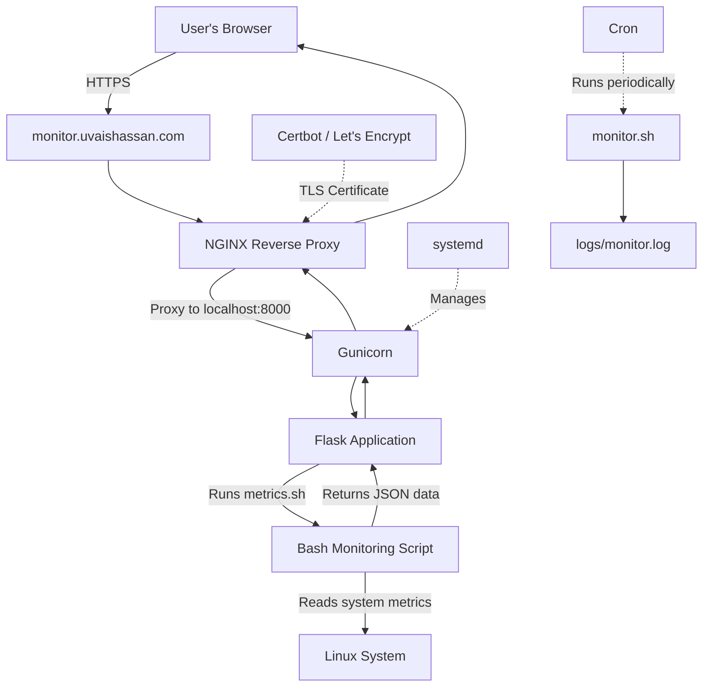

# Linux Server Health Monitor

A lightweight Linux monitoring tool built with Bash and Python Flask. It collects system metrics, checks NGINX service status, and displays the results in a browser dashboard.

## Features

- CPU load average and system uptime
- Memory and root filesystem usage
- NGINX service status monitoring
- Disk usage warning threshold
- Scheduled monitoring with cron
- Timestamped log output
- Web dashboard with automatic refresh
- JSON API for system metrics

## Technology Stack

- Ubuntu Linux
- Bash
- Python 3 and Flask
- HTML, CSS, and JavaScript
- systemd and journalctl
- cron

## Architecture



## Project Structure

- `monitor.sh` — human-readable health report
- `metrics.sh` — JSON-formatted system metrics
- `app.py` — Flask web application and metrics API
- `templates/index.html` — browser dashboard
- `logs/` — scheduled monitoring output (not tracked by Git)

## Run Locally

Install the required system packages:

```bash
sudo apt update
sudo apt install python3-venv nginx cron -y
```

Create and activate a virtual environment:

```bash
python3 -m venv .venv
source .venv/bin/activate
pip install flask
```

Start the application:

```bash
python app.py
```

Open http://127.0.0.1:5000 in your browser.

## API

`GET /api/metrics` returns a JSON object containing the hostname, timestamp, uptime, memory usage, disk usage, load average, and NGINX status.

## Scheduled Monitoring

Create a log directory:

```bash
mkdir -p ~/server-health-monitor/logs
```

Add this to your user crontab with `crontab -e`:

```cron
*/5 * * * * /home/uvais/server-health-monitor/monitor.sh >> /home/uvais/server-health-monitor/logs/monitor.log 2>&1
```

Adjust the path if you install the project elsewhere.

## Troubleshooting

Check NGINX status:

```bash
systemctl status nginx --no-pager
```

Inspect service logs:

```bash
sudo journalctl -u nginx -n 50 --no-pager
```

Restart NGINX:

```bash
sudo systemctl restart nginx
```

## Limitations

This project is a learning and demonstration tool, not a production monitoring platform. The current dashboard uses a development Flask server and should not be exposed directly to the public internet. Production deployment requires a proper application server, reverse proxy, and suitable access controls.
