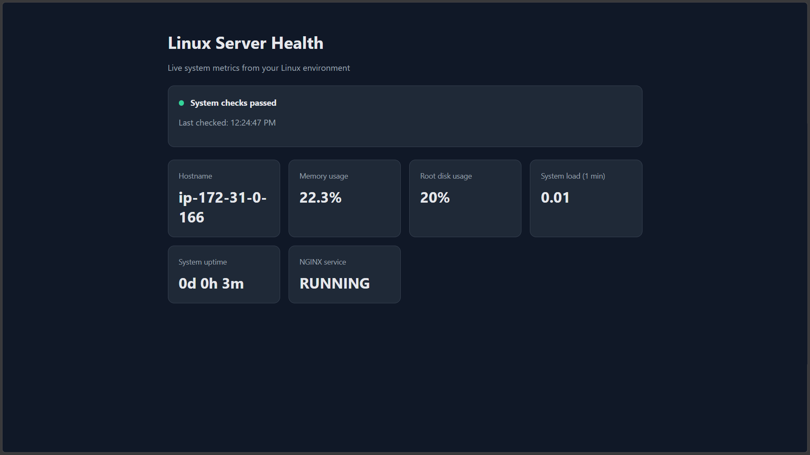
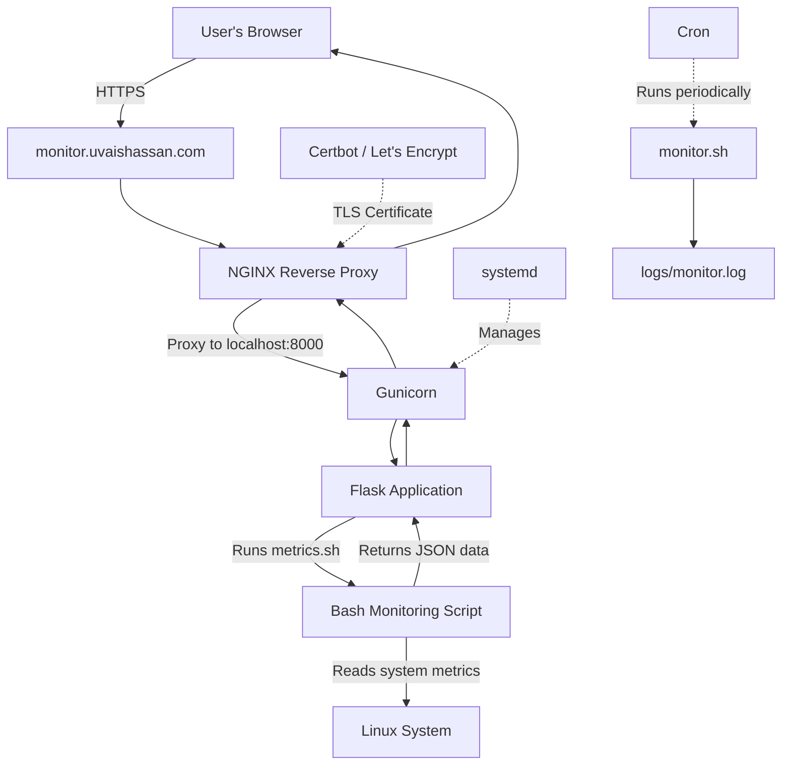

# Linux Server Health Monitor

A lightweight Linux monitoring tool built with Bash and Python Flask. It collects system metrics, checks NGINX service status, and displays the results in a browser dashboard.

## Dashboard Preview



## Features

- CPU load average and system uptime
- Memory and root filesystem usage
- NGINX service status monitoring
- Disk usage warning threshold
- Scheduled monitoring with cron
- Timestamped log output
- Web dashboard with automatic refresh
- JSON API for system metrics

## Technology Stack

- Ubuntu Linux
- Bash
- Python 3 and Flask
- HTML, CSS, and JavaScript
- systemd and journalctl
- cron

## Architecture



## Project Structure

- `monitor.sh` — human-readable health report
- `metrics.sh` — JSON-formatted system metrics
- `app.py` — Flask web application and metrics API
- `templates/index.html` — browser dashboard
- `logs/` — scheduled monitoring output (not tracked by Git)

## Infrastructure Provisioning

The application runs on an AWS EC2 instance in the Mumbai region (`ap-south-1`). The infrastructure was provisioned using the AWS CLI, while DNS and TLS certificate setup were completed using the relevant tools.

### Prerequisites

- AWS CLI installed and configured
- An AWS identity with the required EC2 permissions
- SSH client
- A domain name with DNS management access

Verify the AWS CLI configuration:

```bash
aws configure get region
aws sts get-caller-identity
```

### 1. Create an SSH key pair

Generate an Ed25519 SSH key pair locally:

```bash
ssh-keygen -t ed25519 -f ~/.ssh/server-health-monitor
```

Import the public key into EC2:

```bash
aws ec2 import-key-pair \
  --region ap-south-1 \
  --key-name server-health-monitor-key \
  --public-key-material fileb://$HOME/.ssh/server-health-monitor.pub
```

The private key remains on the local machine and is used to connect to the instance.

### 2. Create a security group

Retrieve the default VPC ID:

```bash
VPC_ID=$(aws ec2 describe-vpcs \
  --region ap-south-1 \
  --filters Name=isDefault,Values=true \
  --query "Vpcs[0].VpcId" \
  --output text)
```

Create the security group:

```bash
aws ec2 create-security-group \
  --region ap-south-1 \
  --group-name server-health-monitor-sg \
  --description "Security group for Server Health Monitor" \
  --vpc-id "$VPC_ID"
```

Retrieve its ID:

```bash
SG_ID=$(aws ec2 describe-security-groups \
  --region ap-south-1 \
  --filters Name=group-name,Values=server-health-monitor-sg \
            Name=vpc-id,Values="$VPC_ID" \
  --query "SecurityGroups[0].GroupId" \
  --output text)
```

Allow SSH, HTTP and HTTPS traffic:

```bash
aws ec2 authorize-security-group-ingress \
  --region ap-south-1 \
  --group-id "$SG_ID" \
  --ip-permissions '[
    {"IpProtocol":"tcp","FromPort":22,"ToPort":22,"IpRanges":[{"CidrIp":"0.0.0.0/0"}]},
    {"IpProtocol":"tcp","FromPort":80,"ToPort":80,"IpRanges":[{"CidrIp":"0.0.0.0/0"}]},
    {"IpProtocol":"tcp","FromPort":443,"ToPort":443,"IpRanges":[{"CidrIp":"0.0.0.0/0"}]}
  ]'
```

HTTP and HTTPS serve the public dashboard. SSH provides administrative access.

**Security note:** For a production deployment, restrict SSH access to a trusted IP address or VPN rather than allowing connections from anywhere.

### 3. Launch the EC2 instance

The instance uses Ubuntu 24.04 LTS, a `t3.small` instance type and a 16 GiB `gp3` root EBS volume.

Retrieve an available subnet in the default VPC:

```bash
SUBNET_ID=$(aws ec2 describe-subnets \
  --region ap-south-1 \
  --filters Name=vpc-id,Values="$VPC_ID" \
  --query "Subnets[0].SubnetId" \
  --output text)
```

Launch the instance:

```bash
aws ec2 run-instances \
  --region ap-south-1 \
  --image-id ami-094adff9b24048c5c \
  --instance-type t3.small \
  --key-name server-health-monitor-key \
  --network-interfaces "DeviceIndex=0,SubnetId=$SUBNET_ID,Groups=$SG_ID,AssociatePublicIpAddress=true" \
  --block-device-mappings '[{"DeviceName":"/dev/sda1","Ebs":{"VolumeSize":16,"VolumeType":"gp3","DeleteOnTermination":true}}]' \
  --tag-specifications 'ResourceType=instance,Tags=[{Key=Name,Value=server-health-monitor}]' \
  --query "Instances[0].[InstanceId,State.Name]" \
  --output table
```

The AMI ID above is the Ubuntu 24.04 image used during the original deployment in `ap-south-1`. Verify that it is still available before reproducing the deployment.

### 4. Connect to the instance

After the instance reaches the running state, retrieve its public IP address from the EC2 console or AWS CLI, then connect:

```bash
ssh -i ~/.ssh/server-health-monitor ubuntu@<PUBLIC_IP>
```

Install the required system packages, clone the repository, create a Python virtual environment, and install Flask and Gunicorn. Configure the application as a systemd service and use NGINX as the reverse proxy.

### 5. Configure DNS and HTTPS

- Create an A record for `monitor` pointing to the EC2 public IP.
- Configure NGINX to proxy requests to Gunicorn on `127.0.0.1:8000`.
- Use Certbot with Let's Encrypt to obtain and configure the HTTPS certificate.
- Verify certificate renewal with `sudo certbot renew --dry-run`.

**Important:** The EC2 public IP can change after stopping and starting the instance. Update the DNS record when necessary, or use an Elastic IP to maintain a stable public address.

### 6. Manage infrastructure costs

Stop the EC2 instance when it is not needed for demonstrations. The attached EBS volume continues to incur storage charges while the instance is stopped. Review AWS pricing and remove resources that are no longer required.

## Run Locally

Install the required system packages:

```bash
sudo apt update
sudo apt install python3-venv nginx cron -y
```

Create and activate a virtual environment:

```bash
python3 -m venv .venv
source .venv/bin/activate
pip install flask
```

Start the application:

```bash
python app.py
```

Open http://127.0.0.1:5000 in your browser.

## API

`GET /api/metrics` returns a JSON object containing the hostname, timestamp, uptime, memory usage, disk usage, load average, and NGINX status.

## Scheduled Monitoring

Create a log directory:

```bash
mkdir -p ~/server-health-monitor/logs
```

Add this to your user crontab with `crontab -e`:

```cron
*/5 * * * * /home/uvais/server-health-monitor/monitor.sh >> /home/uvais/server-health-monitor/logs/monitor.log 2>&1
```

Adjust the path if you install the project elsewhere.

## Troubleshooting

Check NGINX status:

```bash
systemctl status nginx --no-pager
```

Inspect service logs:

```bash
sudo journalctl -u nginx -n 50 --no-pager
```

Restart NGINX:

```bash
sudo systemctl restart nginx
```

## Limitations

This project is a learning and demonstration tool, not a production monitoring platform. The current dashboard uses a development Flask server and should not be exposed directly to the public internet. Production deployment requires a proper application server, reverse proxy, and suitable access controls.
